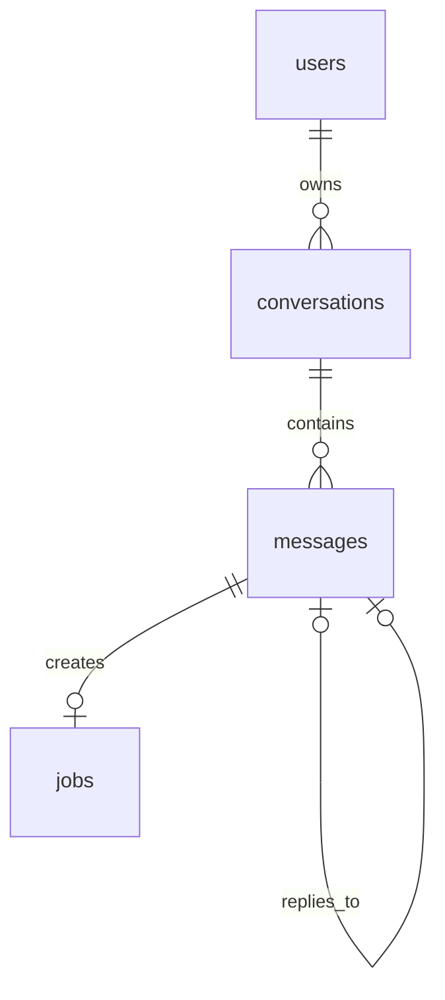

# AgentHub 起步阶段四张数据表设计

更新日期：2026 年 10 月 18 日。状态：起步阶段的具体设计建议。

最初开发只需要一个 PostgreSQL 数据库，以及 `users`、`conversations`、`messages`、`jobs` 四张表。它们共同支持这条链路：员工创建会话并发送消息，API 保存消息和待办，worker 处理待办并保存回复，员工随后查询聊天记录。

这里具体约定每个字段的含义、PostgreSQL 类型、空值和默认值，以及四张表之间的关系。它是 [最早期后端开发规划](AGENTHUB_BACKEND_INITIAL_DEVELOPMENT_PLAN.md) 的数据设计，任务执行、审批及模拟业务数据会随 [后端总体规划](AGENTHUB_BACKEND_PLAN.md) 的后续功能加入。

## 四张表分别负责什么

| 表名 | 中文含义 | 一条记录代表什么 |
| --- | --- | --- |
| `users` | 用户 | 一名使用 AgentHub 的员工 |
| `conversations` | 会话 | 该员工的一次聊天 |
| `messages` | 消息 | 聊天中的一条用户消息或系统回复 |
| `jobs` | 后台待办 | 交给 worker 处理某条用户消息的一项工作 |

用户是系统的使用者，不是后续模拟业务中的客户。会话是一组消息的容器；消息记录聊天内容；待办记录处理情况。

图中一对多表示“一条前者记录可以关联多条后者记录”。具体关系是：

- 一个用户可以创建多个会话，每个会话属于一个用户。
- 一个会话可以有多条消息，每条消息属于一个会话。
- 每条用户消息应有一条待办；系统回复不创建待办。提交时一起保存消息和待办，保证这个要求。
- 本阶段每条用户消息最多收到一条最终回复；回复必须指向同会话中的那条用户消息。

数据库外键和唯一约束只能直接保证“一条消息最多有一条待办”；“提交后一定有待办”还要靠消息和待办一起提交来保证。

## 数据类型和共同约定

主键是记录自己的唯一编号；外键是指向另一条记录的编号。`NULL` 表示当前没有这个值，与空字符串、数字零含义不同。

| 类型或约定 | 在这里怎样使用 |
| --- | --- |
| `UUID` | 保存记录编号，例如 `550e8400-e29b-41d4-a716-446655440000`。后端为新记录生成 UUID；关联字段使用相同类型 |
| `TEXT` | 保存文字，包括登录名、消息正文和状态名称 |
| `BOOLEAN` | 保存 `TRUE` 或 `FALSE`，用于用户是否启用 |
| `INTEGER` | 保存整数，用于处理尝试次数 |
| `BIGINT` | 保存范围更大的整数，用于会话中的消息顺序号 |
| `TIMESTAMPTZ` | 保存明确的时间点。数据库连接统一使用 UTC，页面按需要转换显示时区 |
| `now()` | 表示数据库当前事务的开始时间，用作创建时间的默认值 |

UUID 是 PostgreSQL 支持的编号类型；`TIMESTAMPTZ` 保存时间点，并按连接时区显示。消息排序另用顺序号，不依赖两个时间戳一定不同。[UUID 类型说明](https://www.postgresql.org/docs/current/datatype-uuid.html)、[日期与时间类型说明](https://www.postgresql.org/docs/current/datatype-datetime.html)

下文的“不可空”表示建表时设置 `NOT NULL`。“后端生成”表示程序必须提供这个值，不是数据库已经配置了默认值。`updated_at` 也需要程序在更新时主动填写，默认值只负责首次插入。

## 用户表 users

用户表回答两个问题：这是谁的账号，以及哪些会话属于这个人。

| 字段 | PostgreSQL 类型 | 空值与默认值 | 含义 |
| --- | --- | --- | --- |
| `id` | `UUID` | 不可空；后端生成 | 用户编号，主键 |
| `username` | `TEXT` | 不可空；无默认值 | 登录名，例如 `alice`；去掉首尾空格、统一转为小写后保存，不能为空且全表唯一 |
| `display_name` | `TEXT` | 可空；默认 `NULL` | 页面显示的名字，例如“张同学”；没有填写时显示登录名 |
| `password_hash` | `TEXT` | 不可空；无默认值 | 密码哈希，由后端的密码处理库生成；不保存原始密码 |
| `is_active` | `BOOLEAN` | 不可空；默认 `TRUE` | 账号是否启用；停用后不能继续访问接口 |
| `created_at` | `TIMESTAMPTZ` | 不可空；默认 `now()` | 账号创建时间 |
| `updated_at` | `TIMESTAMPTZ` | 不可空；默认 `now()` | 账号资料最近修改时间 |

主键为 `id`，登录名设置 `UNIQUE(username)`。后端返回用户资料时，不返回 `password_hash`。

本地开发可以先预置一个测试账号及其密码哈希，由服务端选用这个测试身份。正式登录接入后，身份来自登录验证；不能让客户端随意填写一个 `user_id` 就获得该用户的权限。

## 会话表 conversations

会话表保存“这一组聊天属于谁”。同一个员工可以创建多个会话。

| 字段 | PostgreSQL 类型 | 空值与默认值 | 含义 |
| --- | --- | --- | --- |
| `id` | `UUID` | 不可空；后端生成 | 会话编号，主键 |
| `user_id` | `UUID` | 不可空；无默认值 | 会话所属用户；外键指向 `users.id` |
| `title` | `TEXT` | 不可空；默认 `'新对话'` | 会话标题；保存时不能为空 |
| `next_message_seq` | `BIGINT` | 不可空；默认 `1` | 下一条消息将使用的顺序号，必须大于零 |
| `created_at` | `TIMESTAMPTZ` | 不可空；默认 `now()` | 会话创建时间 |
| `updated_at` | `TIMESTAMPTZ` | 不可空；默认 `now()` | 会话最近更新的时间；收到新消息或修改标题时更新 |

`next_message_seq` 用来分配本会话的第 1、2、3 条消息。写入消息时，程序先锁定这条会话记录，取得当前号码并将其加一，再保存消息；这些步骤在同一个事务里完成。这样两个请求同时写消息，也不会拿到相同号码。

查询或写入会话内容前，API 必须确认 `conversations.user_id` 等于当前登录用户。消息和待办的归属可以沿关联记录查到，不需要在每张表重复保存用户编号。

## 消息表 messages

用户发送的文字与 worker 生成的最终回复都保存在消息表，用 `role` 区分。提示词配置和工具调用结果不放在这张聊天表中。

| 字段 | PostgreSQL 类型 | 空值与默认值 | 含义 |
| --- | --- | --- | --- |
| `id` | `UUID` | 不可空；后端生成 | 消息编号，主键 |
| `conversation_id` | `UUID` | 不可空；无默认值 | 所属会话；外键指向 `conversations.id` |
| `role` | `TEXT` | 不可空；无默认值 | 发言者类型，本阶段只允许 `user` 或 `assistant` |
| `content` | `TEXT` | 不可空；无默认值 | 消息正文，例如“你好”或“消息已收到”；拒绝空文本和全空白文本，其余内容按原文保存 |
| `seq` | `BIGINT` | 不可空；无默认值 | 该消息在会话中的顺序号，由 `next_message_seq` 分配，必须大于零 |
| `reply_to_message_id` | `UUID` | 按角色决定；默认 `NULL` | 当前回复对应的用户消息；外键指向 `messages.id` |
| `submission_key` | `UUID` | 按角色决定；默认 `NULL` | 用户提交标识，用于识别网络重试造成的重复提交 |
| `created_at` | `TIMESTAMPTZ` | 不可空；默认 `now()` | 消息保存时间 |

### 用户消息与系统回复的填写规则

| 规则 | 用户消息 `user` | 系统回复 `assistant` |
| --- | --- | --- |
| 谁创建 | API 接收员工输入后创建 | worker 完成处理后创建 |
| `reply_to_message_id` | 必须为 `NULL` | 必须填写对应的用户消息编号 |
| `submission_key` | 必须填写 | 必须为 `NULL` |
| 是否创建待办 | 是 | 否 |

`role` 与这两个字段的搭配可以用数据库 `CHECK` 约束检查。回复目标是否属于同一会话、是否为用户消息，则由 worker 在保存回复的事务中检查；单独一条外键不足以保证这两点。

### 消息排序和防重复

- `UNIQUE(conversation_id, seq)`：同一会话不能有重复顺序号。查询历史时按 `seq` 排序。
- `UNIQUE(conversation_id, submission_key)`：同一会话内，同一次用户提交只能保存一次。
- `UNIQUE(reply_to_message_id)`：本阶段同一条用户消息最多有一条最终回复。

后两项唯一约束采用 PostgreSQL 默认的空值处理方式，允许多条记录的对应字段为 `NULL`，因此不会限制正常的系统回复或用户消息数量。[唯一约束说明](https://www.postgresql.org/docs/current/ddl-constraints.html#DDL-CONSTRAINTS-UNIQUE-CONSTRAINTS)

前端或接口测试工具在首次提交时生成 `submission_key`。请求超时后重发，继续使用同一个标识；员工确实要再发一遍相同文字时，使用新的标识。

API 找到相同会话和提交标识时，比较本次正文与已保存正文：完全相同就返回原来的消息与待办编号；内容不同就返回冲突。这样不需要额外保存一份正文摘要。

`seq` 表示实际保存顺序，不承诺多个并行请求的回复一定按请求顺序完成。第一轮联调先逐条发送并等待回复；接入模型时再明确同一会话的并发处理政策。

## 后台待办表 jobs

待办表记录“哪条用户消息还需要处理，以及处理到了什么状态”。它不重复保存消息正文，worker 通过 `source_message_id` 找到原消息。

### 工作与结果字段

| 字段 | PostgreSQL 类型 | 空值与默认值 | 含义 |
| --- | --- | --- | --- |
| `id` | `UUID` | 不可空；后端生成 | 待办编号，主键 |
| `source_message_id` | `UUID` | 不可空；无默认值 | 来源用户消息；外键指向 `messages.id`，本阶段全表唯一 |
| `kind` | `TEXT` | 不可空；默认 `'PROCESS_MESSAGE'` | 工作类型，本阶段只允许 `PROCESS_MESSAGE`，即处理一条消息 |
| `status` | `TEXT` | 不可空；默认 `'QUEUED'` | 当前状态，只允许下方列出的四种值 |
| `attempts` | `INTEGER` | 不可空；默认 `0` | 已经领取处理的次数；每次领取加一，不能为负数 |
| `available_at` | `TIMESTAMPTZ` | 不可空；默认 `now()` | 最早可以领取的时间；当前即刻处理，后续可用于延迟重试 |
| `last_error` | `TEXT` | 可空；默认 `NULL` | 最近一次处理错误的摘要；不要写入密码、连接凭据或密钥；成功后清空 |
| `created_at` | `TIMESTAMPTZ` | 不可空；默认 `now()` | 待办创建时间 |
| `updated_at` | `TIMESTAMPTZ` | 不可空；默认 `now()` | 待办状态最近变化的时间 |
| `started_at` | `TIMESTAMPTZ` | 可空；默认 `NULL` | 第一次被领取的时间；后续重试不覆盖 |
| `finished_at` | `TIMESTAMPTZ` | 可空；默认 `NULL` | 成功或最终失败的时间；尚未结束时为空 |

### Worker 领取字段

以下三个字段也属于 `jobs` 表，只是单独解释：

| 字段 | PostgreSQL 类型 | 空值与默认值 | 含义 |
| --- | --- | --- | --- |
| `lease_owner` | `TEXT` | 可空；默认 `NULL` | 当前领取工作的 worker 标识，例如 `worker-1` |
| `lease_token` | `UUID` | 可空；默认 `NULL` | 本次领取的编号，每次重新领取都由后端生成新值 |
| `lease_expires_at` | `TIMESTAMPTZ` | 可空；默认 `NULL` | 本次处理权到期的时间 |

例如 worker A 领取了 J1，拿到领取编号 L1。A 中断后，后续接管程序可为 J1 生成新编号 L2。A 即使恢复，也不能再使用旧编号 L1 保存结果。

程序写入回复和标记完成时，必须核对工作仍为 `RUNNING`、领取编号仍匹配且处理权未到期；这两项写入在同一个事务中提交。核对不通过就整体回滚。仅在表中保存这三个字段，不会自动阻止旧 worker 写入。

续期、超时接管和自动重试需要相应程序逻辑；它们的具体时间与次数在开发时统一配置，并通过中断测试验证。

### 状态和字段搭配

| `status` | 中文含义 | 字段要求 |
| --- | --- | --- |
| `QUEUED` | 等待领取 | 三个领取字段和 `finished_at` 均为空 |
| `RUNNING` | 正在处理 | 三个领取字段及 `started_at` 均有值，`attempts` 至少为 1；`finished_at` 为空 |
| `SUCCEEDED` | 已成功保存回复 | 三个领取字段清空，填写 `started_at` 和 `finished_at`，清空 `last_error` |
| `FAILED` | 本次工作最终失败 | 三个领取字段清空，填写 `started_at`、`finished_at` 和错误摘要 |

正常过程是 **QUEUED → RUNNING → SUCCEEDED**。当前固定回复阶段发生处理错误时，记录为 **FAILED**，先让错误可见。后续引入重试或超时接管时，允许重新排队，但必须同时使旧领取编号失效，并清空结束时间。

本阶段不在这里增加“等待审批”等业务状态。`jobs` 只记录一次消息处理工作的调度情况；持续任务和审批会使用后续表。

## 表间约束与查询索引

### 外键关系

| 外键字段 | 指向 | 保证什么 |
| --- | --- | --- |
| `conversations.user_id` | `users.id` | 会话必须属于一个存在的用户 |
| `messages.conversation_id` | `conversations.id` | 消息必须属于一个存在的会话 |
| `messages.reply_to_message_id` | `messages.id` | 非空时，回复必须指向一条存在的消息 |
| `jobs.source_message_id` | `messages.id` | 待办必须有一条存在的来源消息 |

这些外键的删除行为先使用 `ON DELETE RESTRICT`，避免误删后失去关联记录。本阶段不提供硬删除用户或聊天的接口；停用账号使用 `is_active`。

外键保证记录存在，不代表当前用户有权访问。API 仍需沿“待办 → 消息 → 会话 → 用户”的关系检查归属。

### 建表时的检查

建表时设置四张表的主键、上述外键和唯一约束，并设置以下 `CHECK` 约束：

- 登录名必须非空，并且已经去掉首尾空格、转为小写；会话标题和消息正文不能是空文本或全空白文本。
- `next_message_seq` 和 `seq` 大于零，`attempts` 不小于零。
- `role`、`kind`、`status` 只能使用本阶段约定的值。
- 用户消息与系统回复的提交标识、回复目标满足前面的角色规则。
- 工作状态与领取字段、开始时间、结束时间满足前面的状态表；失败时错误摘要非空。

来源必须是用户消息、回复目标必须是同会话用户消息等跨记录规则，由后端在事务中检查。普通 `CHECK` 约束不能可靠地检查其他记录的内容。[检查约束说明](https://www.postgresql.org/docs/current/ddl-constraints.html#DDL-CONSTRAINTS-CHECK-CONSTRAINTS)

### 支持常用查询的索引

| 查询需求 | 建议的索引 |
| --- | --- |
| 查询用户的会话，最近更新的排在前面 | `conversations(user_id, updated_at DESC, id)` |
| 按顺序读取会话消息 | 直接使用 `UNIQUE(conversation_id, seq)` 已建立的索引 |
| 查找重复提交 | 直接使用 `UNIQUE(conversation_id, submission_key)` 已建立的索引 |
| 根据用户消息查待办 | 直接使用 `UNIQUE(source_message_id)` 已建立的索引 |
| 查找可以领取的工作 | `jobs(status, available_at, created_at)` |
| 后续查找领取已过期的工作 | 为 `status = 'RUNNING'` 的记录建立 `lease_expires_at` 索引 |

主键和唯一约束会建立相应唯一索引，不必为完全相同的字段组合再建一份。[主键与唯一约束说明](https://www.postgresql.org/docs/current/ddl-constraints.html)

## 一次发消息如何使用四张表

下面用 U1、C1、M1、M2、J1 代替真实 UUID，便于阅读。

### 创建用户与会话

预置用户 U1，登录名为 `alice`。API 为 U1 创建会话 C1，填写 `user_id = U1`，初始 `next_message_seq = 1`。

### 用户发送你好

测试工具为这次提交生成标识 K1，向 C1 发送“你好”。API 检查 C1 属于 U1，然后在一个事务里：

1. 锁定 C1，检查是否已经处理过 K1；如果是同一正文，返回原消息和待办编号。
2. 如果是新提交，为消息分配顺序号 1，把会话的下一个顺序号改为 2，并更新会话时间。
3. 保存用户消息 M1：`role = 'user'`、`content = '你好'`、`submission_key = K1`。
4. 保存待办 J1：`source_message_id = M1`、`status = 'QUEUED'`。
5. 一起提交，返回 M1 和 J1 的编号。

这样不会出现“消息保存了，却没有待办”的半成品；若数据库提交失败，API 不能报告已受理。事务保证这些修改要么全部成功，要么全部不保存。[事务说明](https://www.postgresql.org/docs/current/tutorial-transactions.html)

### Worker 产生固定回复

worker 以原子操作领取 J1，改成 `RUNNING`，将 `attempts` 加一，并填写开始时间与三个领取字段。“先查询，再无条件更新”不能保证多个 worker 不会领取同一工作。

生成固定文字“消息已收到”后，worker 在同一个完成事务中核对当前领取权，锁定 C1 并取得下一个顺序号，然后保存：

| 记录 | 本次保存的主要内容 |
| --- | --- |
| 回复消息 M2 | `conversation_id = C1`、`role = 'assistant'`、`content = '消息已收到'`、`seq = 2`、`reply_to_message_id = M1` |
| 会话 C1 | `next_message_seq = 3`，更新 `updated_at` |
| 待办 J1 | 改成 `SUCCEEDED`，填写完成时间，清空三个领取字段和错误摘要 |

完成时的领取条件不再满足，或者任何写入失败，就回滚整个完成事务。查询 C1 的消息并按 `seq` 排序后，看到的就是：用户“你好”，系统“消息已收到”。

### 请求重发或 worker 重启

相同 K1、相同正文的请求再次到达时，API 返回原 M1、J1，不新增记录。已经成功的 J1 不会再次领取；唯一回复约束也防止同一用户消息产生两条最终回复。

未领取的待办在 worker 停止后仍然存在。处理中崩溃的待办则要通过领取过期与接管逻辑恢复；容器重启和表里存在记录，本身不等于这段恢复逻辑已经实现。

## 本阶段交付和后续扩展

先建立上述四张表及约束，再实现消息受理、查询和固定回复。联调至少检查：消息与待办一起保存、同一提交不会重复入库、回复可以追溯来源、会话访问有归属检查，以及容器重建后记录仍在。

后续接入业务任务时，新增执行、工具、方案、审批和事件等表，不把这些内容都塞进 `jobs`。本阶段的“一条来源消息只有一条待办”和“只有一种工作类型”针对消息处理；引入审批后恢复等新工作类型时，需要通过数据库迁移调整对应的唯一规则和类型约束。
