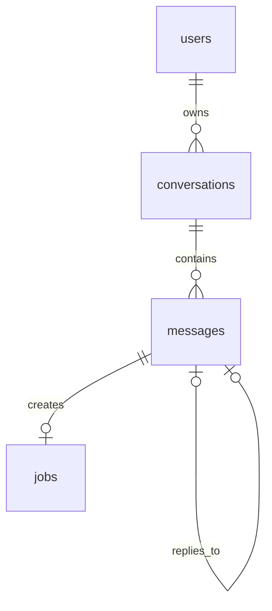

# Initial Backend Database

The running backend uses one PostgreSQL database with four application tables. API and worker processes share it; they coordinate through durable jobs rather than in-memory state. Alembic also maintains its own `alembic_version` bookkeeping table.

Every conversation has one account owner. User messages create processing jobs; assistant replies do not. Each user message can have at most one final reply in this initial milestone.

## Shared conventions

- IDs and foreign-key IDs use `UUID`. Application code generates IDs.
- Timestamps use `TIMESTAMPTZ`; connections use UTC. Creation timestamps default to `now()`.
- `updated_at` defaults to `now()` on insertion and is explicitly changed by application code on updates.
- `TEXT` holds text, including Unicode user content. Public defaults and runtime messages are English.
- Foreign keys use `ON DELETE RESTRICT`. There are no hard-delete API endpoints.
- Account ownership is enforced by the API; an existing foreign-key target is not permission to access it.

The following tables describe the current models after migration `0002_english_defaults`. “Required” means `NOT NULL`; “nullable” means SQL `NULL` is allowed.

## Users

| Field | PostgreSQL type | Nullability and default | Meaning |
| --- | --- | --- | --- |
| `id` | `UUID` | Required; application-generated | Primary key |
| `username` | `TEXT` | Required; unique | Normalized login name; the account CLI accepts 1–64 ASCII letters, digits, dots, hyphens or underscores |
| `display_name` | `TEXT` | Nullable | Optional display name |
| `password_hash` | `TEXT` | Required | Salted scrypt hash, never returned by the API |
| `is_active` | `BOOLEAN` | Required; `true` | Disabled accounts cannot authenticate |
| `created_at` | `TIMESTAMPTZ` | Required; `now()` | Account creation |
| `updated_at` | `TIMESTAMPTZ` | Required; `now()` | Last account change |

`username` is unique, lowercase, trimmed and nonblank. These accounts represent employees using AgentHub, not simulated business customers.

## Conversations

| Field | PostgreSQL type | Nullability and default | Meaning |
| --- | --- | --- | --- |
| `id` | `UUID` | Required; application-generated | Primary key |
| `user_id` | `UUID` | Required | Foreign key to the owning `users.id` |
| `title` | `TEXT` | Required; `New conversation` | Nonblank conversation title |
| `next_message_seq` | `BIGINT` | Required; `1` | Next positive sequence number to allocate |
| `created_at` | `TIMESTAMPTZ` | Required; `now()` | Conversation creation |
| `updated_at` | `TIMESTAMPTZ` | Required; `now()` | Last title or message change |

Each writer locks the conversation row before allocating a sequence number. Allocation, message insertion and the conversation update are committed together. An index on `(user_id, updated_at DESC, id)` supports listing an account's recent conversations.

## Messages

| Field | PostgreSQL type | Nullability and default | Meaning |
| --- | --- | --- | --- |
| `id` | `UUID` | Required; application-generated | Primary key |
| `conversation_id` | `UUID` | Required | Foreign key to `conversations.id` |
| `role` | `TEXT` | Required | `user` or `assistant` |
| `content` | `TEXT` | Required | Nonblank original text; API submissions accept up to 20,000 characters |
| `seq` | `BIGINT` | Required; positive | Order within the conversation |
| `reply_to_message_id` | `UUID` | Nullable by role | Self-referencing foreign key identifying the source user message |
| `submission_key` | `UUID` | Nullable by role | Caller-generated identifier for submission retries |
| `created_at` | `TIMESTAMPTZ` | Required; `now()` | Message insertion time |

A check constraint requires user messages to have a submission key and no reply target. Assistant messages must have a reply target and no submission key. The worker checks that the target is a user message in the same conversation.

Unique constraints enforce `(conversation_id, seq)`, `(conversation_id, submission_key)` and `reply_to_message_id`. Default PostgreSQL null handling allows multiple null keys. Repeating a submission key with identical text returns the original receipt; different text returns `409`.

Sequence order reflects insertion order, not guaranteed completion order for concurrent requests. Prompt configuration and tool results are not stored as chat messages in this milestone.

## Jobs

| Field | PostgreSQL type | Nullability and default | Meaning |
| --- | --- | --- | --- |
| `id` | `UUID` | Required; application-generated | Primary key |
| `source_message_id` | `UUID` | Required; unique | Foreign key to the source `messages.id` |
| `kind` | `TEXT` | Required; `PROCESS_MESSAGE` | Only implemented job type |
| `status` | `TEXT` | Required; `QUEUED` | `QUEUED`, `RUNNING`, `SUCCEEDED` or `FAILED` |
| `attempts` | `INTEGER` | Required; `0` | Nonnegative number of claims, including recovery attempts |
| `available_at` | `TIMESTAMPTZ` | Required; `now()` | Earliest claim time for queued work |
| `last_error` | `TEXT` | Nullable | Sanitized failure summary, cleared on success |
| `created_at` | `TIMESTAMPTZ` | Required; `now()` | Job insertion time |
| `updated_at` | `TIMESTAMPTZ` | Required; `now()` | Last job-state change |
| `started_at` | `TIMESTAMPTZ` | Nullable | First claim time, retained on recovery |
| `finished_at` | `TIMESTAMPTZ` | Nullable | Final success or failure time |
| `lease_owner` | `TEXT` | Nullable | Current worker instance identifier |
| `lease_token` | `UUID` | Nullable | New ownership token for each claim |
| `lease_expires_at` | `TIMESTAMPTZ` | Nullable | Deadline for the current claim |

State constraints require running jobs to have all three ownership fields, a start time and at least one attempt. Queued jobs have no ownership or finish time. Terminal states clear ownership and set a finish time; success clears the error, while failure requires an error summary.

An index on `(status, available_at, created_at)` supports ready-work selection. A partial index on `lease_expires_at` for running jobs supports expiration checks.

## Transaction and recovery behavior

1. The API checks ownership and locks the conversation. It atomically allocates a sequence number, inserts the user message and inserts its job. Unique constraints alone guarantee at most one job; the transaction ensures that each accepted user message actually has one.
2. A worker locks a claimable row using `FOR UPDATE SKIP LOCKED`, increments attempts and assigns a new lease token. Expired running work can be reclaimed, subject to the configured attempt limit.
3. The worker saves the final reply, advances the conversation counter and marks the job successful in one transaction. A live-time ownership check is repeated before completion; failure rolls back the reply and sequence change as well.

The normal path is `QUEUED → RUNNING → SUCCEEDED`. Processing exceptions become `FAILED`. Interrupted work can be reclaimed after lease expiry; the defaults are 60 seconds and at most three claims. Long-running lease renewal is not implemented for the fixed-reply milestone.

These guarantees apply to database chat writes. They are not a claim of exactly-once external refunds or business actions, which are not implemented yet.

## Migration and review notes

`0001_initial` contains the historical initial DDL. `0002_english_defaults` changes only the default for future title inserts; existing titles and messages remain unchanged. The English default is also defined in the request schema and ORM model.

Later business workflows will add execution, tool, proposal, approval and event tables. New job types will require deliberate migration of the current job-kind and source-message uniqueness rules. See the [team guide](../README.md) for migration commands and test isolation.
