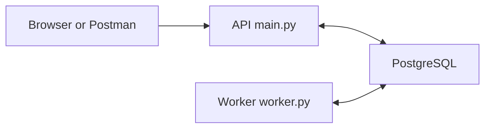

# Backend Code Structure

The current backend accepts authenticated chat messages, saves them in PostgreSQL, and uses a separate worker to produce a fixed reply or an optional model-generated answer. This guide explains where that behavior lives. For the latest model settings, limits and startup options, use [Worker baseline](WORKER_BASELINE.md); for general startup commands, use the [team guide](../README.md).

## Repository map

```text
compose.yaml                 Starts and connects the services
.env.example                 Shared configuration template
scripts/init_env.py          Creates private environment configuration
backend/
  Dockerfile                 Builds runtime and test images
  app/                       API, database access, accounts and worker
  migrations/                Versioned database changes
  tests/                     PostgreSQL integration tests
  requirements*.in           Maintained dependency lists
  requirements*.txt          Resolved dependency versions
  pyproject.toml             Test and code-check settings
  alembic.ini                Migration-tool configuration
.github/workflows/ci.yml     Automated checks on GitHub
docs/                        English guides and architecture material
docs/developer/zh-CN/        Chinese team guides and planning notes
```

Files are not individual services. API, worker, migration and account commands share the same runtime image, but execute different entry points.

## Startup and containers

[compose.yaml](../compose.yaml) controls the startup order:

```text
db becomes healthy → migrate finishes → bootstrap finishes
                                          ├─ api runs
                                          └─ worker runs
```

| Service | What it does | How long it runs |
| --- | --- | --- |
| `db` | Runs PostgreSQL; data lives in the `postgres_data` volume | Continuous |
| `migrate` | Runs `alembic upgrade head` to apply pending schema revisions | Exits after completion |
| `bootstrap` | Runs `app.manage bootstrap` to create the first account if absent | Exits after completion |
| `api` | Uvicorn serves the FastAPI application in `app.main` | Continuous |
| `worker` | Runs `app.worker` to claim and process jobs | Continuous |
| `admin` | Runs account-management commands when explicitly requested | One command at a time |
| `test-db` | Provides a separate disposable PostgreSQL database | Test profile only |
| `test` | Runs pytest in the test image | Exits after tests |

The Dockerfile's `runtime` stage contains application dependencies and runs as a non-root user. Its `test` stage adds test tools. Compose passes configuration into containers; the API binds to loopback by default, while PostgreSQL is accessible only inside the Compose network.

## Application modules

All paths below are under `backend/app/`.

| File | Responsibility |
| --- | --- |
| `__init__.py` | Marks the directory as the `app` Python package |
| `config.py` | Reads environment variables, builds the database URL and validates worker timing values |
| `db.py` | Creates each process's database connection pool and session factory; releases request sessions |
| `models.py` | Maps `users`, `conversations`, `messages` and `jobs` to Python classes, including database constraints |
| `schemas.py` | Defines accepted request fields and returned response fields; validates input with Pydantic |
| `security.py` | Verifies HTTP Basic credentials, salted scrypt hashes and account activation |
| `main.py` | Defines HTTP endpoints, checks ownership and coordinates database operations |
| `worker.py` | Claims ordered jobs, loads context, renews leases, saves replies, retries transient errors and handles expired ownership |
| `replies.py` | Provides fixed responses or bounded OpenAI Responses API text chat |
| `static/` | Serves the lightweight browser development client through the API |
| `manage.py` | Implements bootstrap, account creation and password-change commands |
| `smoke.py` | Calls the running API and waits for the independent worker to verify the complete path |

Three files describe different boundaries: **`schemas.py` defines API data; `models.py` describes stored data; migrations change the actual database.** Changing a model alone does not upgrade an existing database.

`main.py` provides health and account information, conversation creation/listing, message submission/history, and job status. Ownership comes from authentication, not a user ID supplied in a request body.

## One message through the system



1. `security.py` authenticates the account and `schemas.py` validates its submitted text and UUID key.
2. `main.py` checks conversation ownership, locks the conversation and allocates a message sequence number.
3. One transaction saves the user message, advances the sequence counter and creates a queued job. The API returns the message and job IDs.
4. `worker.py` claims a job using a row lock that skips work held by other workers. It assigns a fresh ownership token and an expiry time.
5. The worker loads bounded conversation context and generates a fixed or model reply. One transaction saves it, advances the sequence and marks the job successful, conditional on the claim still being valid.
6. The client queries message history or job status through the API.

`messages` stores what was said; `jobs` stores processing state. Reusing a submission key with identical text returns the original IDs; changing the text returns `409`. Expired claims can be recovered, and an old token cannot complete a job after ownership changes. A background heartbeat renews the lease during model calls; database sessions are closed between checkpoints and renewals.

## Database migrations

| File | Responsibility |
| --- | --- |
| `backend/alembic.ini` | Locates the migration directory and project imports |
| `backend/migrations/env.py` | Connects Alembic to the configured database and loads model metadata |
| `backend/migrations/script.py.mako` | Template for creating new revision files |
| `backend/migrations/versions/0001_initial.py` | Creates the four initial tables, constraints and indexes using frozen SQL |
| `backend/migrations/versions/0002_english_defaults.py` | Sets the English default for future conversation titles, without rewriting existing records |

Alembic records the applied revision in `alembic_version` and executes pending revisions. Add a new migration for a schema change rather than editing one already used by the team. Field definitions are explained in the [database reference](BACKEND_DATABASE.md).

## Dependencies and verification

| File | Responsibility |
| --- | --- |
| `backend/requirements.in` | Direct runtime dependencies and allowed version ranges |
| `backend/requirements.txt` | Exact resolved runtime dependency versions installed by Docker |
| `backend/requirements-dev.in` | Runtime lock plus test and code-check dependencies |
| `backend/requirements-dev.txt` | Exact resolved versions installed in the test image |
| `backend/pyproject.toml` | pytest paths and Ruff checking/formatting rules |
| `backend/tests/conftest.py` | Migrates and resets only the isolated test database; prepares accounts and an HTTP client |
| `backend/tests/test_backend.py` | Checks authentication, message flow, duplicate requests, transactions, worker ownership and migrations |
| `.github/workflows/ci.yml` | Builds images, runs checks and database tests, then starts services and runs the smoke check |

Integration tests exercise controlled success and failure conditions. `smoke.py` instead checks actual HTTP communication between running services. CI currently verifies changes; it does not publish images or deploy the application.

## Configuration and documentation

| File or directory | Responsibility |
| --- | --- |
| `.env.example` | Committed configuration template without real credentials |
| `.env` | Ignored per-environment credentials and settings, generated by `scripts/init_env.py` |
| `.gitignore` | Excludes credentials, virtual environments and generated caches from Git |
| `.gitattributes` | Normalizes source and documentation line endings across platforms |
| `backend/.dockerignore` | Excludes unnecessary local files from the Docker build context |
| `README.md` | Current English startup, API and team workflow guide |
| `docs/README.md` | English documentation index |
| `docs/AGENTHUB_TEAM_HANDOVER.md` | Original English architecture proposal, including future capabilities |
| `docs/BACKEND_DATABASE.md` and `docs/MANUAL_TESTING.md` | Current schema reference and manual checks with result templates |
| `docs/developer/README.md` | Developer-documentation index |
| `docs/developer/zh-CN/` | Chinese setup, code-structure and manual-test guides, plus earlier backend planning drafts |

## Where to make a change

| Change | Start here |
| --- | --- |
| Add or change an endpoint | `main.py`, `schemas.py`, then the integration tests |
| Change a table | `models.py`, a new migration, then migration tests |
| Change background processing | `worker.py` and worker tests |
| Change startup, ports or service configuration | `compose.yaml` and `.env.example` |
| Change credentials or account management | `security.py` or `manage.py` |

Keep runtime messages English and source comments bilingual. A browser development client and optional model calls are available. The team's main frontend, approval workflow, SSE and simulated business service remain planned work.

A useful reading order is `compose.yaml` → `schemas.py` → `models.py` → `main.py` → `worker.py` → migrations → tests.
