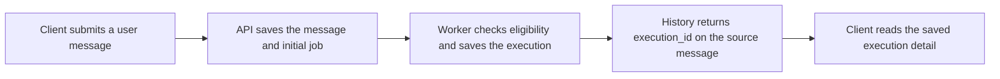

# Refund Execution Details

AgentHub stores the eligibility check, human decision, and any simulated refund for a user turn. API clients read the source message's `execution_id` from conversation history, then use it to retrieve the saved workflow state with `GET /executions/{execution_id}`. The same ID remains addressable as a proposal moves through approval and execution. [API example](../../README.md#read-a-saved-refund-result)

## From a message to a saved execution



The API saves a chat submission and its `PROCESS_MESSAGE` job in one transaction. Its receipt contains `message_id` and `job_id`. In fixed reply mode, the worker evaluates a recognized refund request and persists the eligibility record with the reply or proposal, job completion, and conversation events. `executions.source_message_id` is unique, so one user message can point to at most one saved execution. Reopening the conversation uses that saved record. [Message submission](../../backend/app/main.py) · [Worker completion](../../backend/app/worker.py) · [Database reference](../BACKEND_DATABASE.md#simulated-refund-data)

`read_history()` reuses the existing left join from messages to executions. It sets `MessageOut.execution_id` only on the source user message when an execution exists. FastAPI omits unset response fields, so ordinary messages and refund requests still waiting for their first execution record have no `execution_id`. A client can receive the source message's creation event before the worker has saved the execution. [History projection](../../backend/app/history.py) · [Response schema](../../backend/app/schemas.py)

### Pagination and live updates

- Fetch the first history page with `after_seq=0` or omit `after_seq`. It includes `X-Conversation-Event-Cursor` for SSE v2. PostgreSQL `REPEATABLE READ` lets the first page and the event head share one snapshot, so a worker commit after that snapshot can still be replayed from its cursor.
- For subsequent history pages, set `after_seq` to the last message's `seq`. The event cursor comes only with the first page. Each later page is a separate read.
- Use SSE events to tell the client when to refresh current state. After a completed check, a history refresh can discover the source message's `execution_id`. When the client already has that ID, it can reread the detail as an approval or continuation progresses. [SSE contract](../LIVE_UPDATES.md#durable-event-replay)

## Ownership and the detail query

`GET /executions/{execution_id}` uses the existing HTTP Basic authentication. `read_execution_detail()` follows `Execution.source_message_id` to the user message and its conversation. The same query filters both the execution UUID and `Conversation.user_id` using the authenticated account. A valid UUID belonging to another account and a valid UUID with no matching execution both return HTTP `404` with `{"detail":"Execution not found"}`. [Authentication](../../backend/app/security.py) · [Detail query](../../backend/app/history.py)

One SQL statement reads the optional records with left joins. It takes the continuation job from `ProposalDecision.resume_job_id` and the applied refund from the same proposal's ID. Using the proposal ID keeps two attempts for the same order separate. Each response is built from committed data visible to that statement. [Data models](../../backend/app/models.py)

| Response fields | Source |
| --- | --- |
| `id`, `source_message_id`, `order_id`, `outcome`, `reason_codes`, `refund_amount_minor`, `currency`, `policy_version`, `checked_at` | The saved eligibility record. These fields describe the original check. |
| `status`, `proposal_id`, `expires_at` | Public workflow state and optional proposal metadata. History cards and execution details share the status mapping. |
| `revalidated_at`, `invalidation_reason` | The saved proposal verification time and invalidation code. These match the corresponding proposal fields in history. |
| `decision` | The saved human decision, including `proposal_id`, `decision`, `decided_at`, and `resume_job_id`. |
| `resume_job_status` | Status of the approved continuation, when present. |
| `result` | The applied resolution, including the actual refund amount, currency, order and ticket IDs, saved customer reply, and application time. |

Optional detail fields are `null` when their records are absent. The API sends order numbers, ticket numbers, and amounts in minor units as decimal strings to preserve PostgreSQL `BIGINT` precision in JavaScript. `outcome: "NOT_FOUND"` is a valid saved check result returned with HTTP `200` to the conversation owner. [Public response schemas](../../backend/app/schemas.py) · [Eligibility outcomes](zh-CN/AGENTHUB_READ_ONLY_REFUND_CHECK.md#权限与退款规则)

## Eligibility, approval, and refund status

An approval stores its receipt and creates a `RESUME_EXECUTION` job. The public `status` uses that job's progress while `Execution.status` is `APPROVED`. The worker rechecks the proposal before applying it. For a refund it can apply, the worker commits the applied resolution, ticket update, final reply, and job success in one transaction after verifying its lease. It can also process a stale proposal successfully by saving an invalidation. [Approval route](../../backend/app/main.py) · [Resolution workflow](../../backend/app/resolution_workflow.py) · [Worker lease and completion](../../backend/app/worker.py)

| Scenario | `status` | `decision.decision` | `resume_job_status` | `result` |
| --- | --- | --- | --- | --- |
| Eligibility check finished | `COMPLETED` | No decision | `null` | `null` |
| Proposal awaiting approval | `WAITING_FOR_APPROVAL` | No decision | `null` | `null` |
| Approved continuation queued or running | `QUEUED` or `RUNNING` | `APPROVE` | Same as `status` | `null` |
| Proposal rejected | `REJECTED` | `REJECT` | `null` | `null` |
| Proposal invalidated before approval | `INVALIDATED` | No decision | `null` | `null` |
| Continuation saved an invalidation after approval | `INVALIDATED` | `APPROVE` | `SUCCEEDED` | `null` |
| Approved continuation failed | `FAILED` | `APPROVE` | `FAILED` | `null` |
| Simulated refund saved | `COMPLETED` | `APPROVE` | `SUCCEEDED` | Applied refund record |

For an `INVALIDATED` proposal, `invalidation_reason` can explain why it closed, such as `PROPOSAL_EXPIRED`, `ORDER_CHANGED`, or `POLICY_CHANGED`. The original eligibility remains in `outcome` and `reason_codes`. A completed refund can also have `revalidated_at` set. Older records and eligibility checks can have both audit fields set to `null`. [Revalidation codes](../AGENT_EXECUTION.md#schema-and-api-handoff)

Use the presence of `result` to display a completed refund and read `result.refund_amount_minor` for the actual amount. With freshly seeded demo data, a check for order `1002` yields `INELIGIBLE` with `WINDOW_EXPIRED` and `result: null`. An approved and applied refund for ticket `391` yields `"12999"` in `CAD`, which displays as CAD 129.99. The top-level `refund_amount_minor` is the amount calculated at eligibility check time. [Demo workflow](../WORKER_BASELINE.md#approve-or-reject-a-refund-proposal)

## Verify locally

Run Compose with `REPLY_MODE=fixed` and seed the demo accounts and tickets. Follow MT21 to check history pagination, then to read the original eligibility and an approved refund as Alice and verify the matching `404` responses as Bob. The integrated tests also cover approval and failure states, existing conversations, same-order proposals, and integer precision. [MT21 procedure](../MANUAL_TESTING.md#mt21-read-saved-execution-details)

From the repository root, run the targeted suite against the isolated PostgreSQL test service.

```bash
docker compose --profile test build test
docker compose run --rm test pytest -q tests/test_backend.py tests/test_resolution_workflow.py tests/test_events.py tests/test_event_store.py
```
