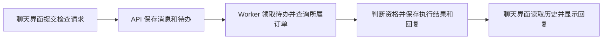

# AgentHub 只读订单与退款资格检查开发说明

本阶段通过现有聊天界面提交一条检查请求，让 worker 查询模拟订单、计算退款资格、保存结构化结论，并通过聊天历史显示结果。工单关联、审批和模拟处置由后续阶段接入。 [演示说明](../../WORKER_BASELINE.md#read-only-refund-check)

## 请求如何流转



1. 前端通过 `POST /conversations/{id}/messages` 提交消息。API 已经会在一个事务内写入消息与 `PROCESS_MESSAGE` 待办，并返回 `202`、`message_id` 和 `job_id`。同一会话内用相同的 `submission_key` 和原文重发，会得到原来的两个 ID。 [消息提交实现](../../../backend/app/main.py)
2. worker 沿用 `claim_job()` 领取待办。在 `REPLY_MODE=fixed` 下支持两条完整的演示句式，`Can order 1001 be refunded?` 和 `订单 1001 能退款吗？`。对来源消息去除首尾空白后匹配整句，只提取处于 PostgreSQL `BIGINT` 正值范围内的 ASCII 数字订单号。其余消息继续走当前回复流程。 [Worker 入口](../../../backend/app/worker.py)
3. 前端继续轮询 `GET /jobs/{job_id}`，再用 `GET /conversations/{id}/messages` 读取回复。系统生成英文文本，例如 `Order 1001 is eligible for a simulated refund of CAD 129.99.`。订单原始资料和内部检查字段留在后端，用户看到结论与原因。 [查询接口](../../../backend/app/main.py)

## PostgreSQL 数据结构

订单、执行记录、待办和聊天消息都存入现有 PostgreSQL。订单记录提供查询事实，执行记录保存本次检查的结论，待办记录用于 worker 调度，聊天消息用于前端显示。

| 表 | 本阶段使用的字段和约束 |
| --- | --- |
| `orders`（新增） | `id BIGINT` 为正整数主键，`assigned_user_id UUID` 引用 `users.id`。付款状态 `payment_status TEXT`、交付状态 `fulfillment_status TEXT`、实付金额 `paid_total_minor BIGINT`、币种 `currency TEXT` 和 `delivered_at TIMESTAMPTZ` 提供判断依据。这五项业务数据允许为 `NULL`，用于表达资料不完整的模拟订单。 |
| `executions`（新增） | `id UUID` 为主键，`source_message_id UUID` 唯一且引用 `messages.id`。保存 `requested_order_id BIGINT`、`outcome TEXT`、`reason_codes JSONB`（原因码数组）、`refund_amount_minor BIGINT`、`currency TEXT`、`policy_version TEXT` 和 `checked_at TIMESTAMPTZ`。用来源消息查到原会话和待办。`requested_order_id` 可以记录查询不到的编号，因此无需订单外键。 |
| `jobs`（已有） | `source_message_id` 关联用户消息，`status` 表示处理状态，领取令牌和过期时间约束 worker 写入。 |
| `messages`（已有） | 保存用户原文和最终回复。回复通过唯一的 `reply_to_message_id` 关联来源消息，通过会话内 `seq` 排序。 |

迁移 `0003_read_only_refund_check` 在 `0002_english_defaults` 之后创建这两张表。账号创建后，运行 `docker compose run --rm admin seed-demo-orders alice bob` 写入四笔订单。命令按账号查找 UUID，在同一事务写入。重复初始化时保留已有记录的归属、金额和交付时间，发现编号与归属冲突时报错。测试 fixture 使用隔离数据库里的账号与订单。 [模型](../../../backend/app/models.py) · [迁移](../../../backend/migrations/versions/0003_read_only_refund_check.py) · [管理命令](../../../backend/app/manage.py)

## 权限与退款规则

worker 按 `job → source message → conversation.user_id` 取得当前用户，在同一个查询条件里匹配 `orders.id` 和 `orders.assigned_user_id`。查不到行时统一得到 `NOT_FOUND`，回复 `Order not found.`，执行记录只保存请求编号和通用结果。由后端从查询到的订单取得金额、币种和日期。 [V1 归属和规则草案](AGENTHUB_BACKEND_V1_SPEC.md)

首版采用演示政策 `DEMO-CAD-30D/v1`。用数据库时钟获取一次 `checked_at`，按 UTC 计算 `delivered_at + 30 × 24 小时`，截止时刻仍符合时间要求。判断函数接收订单与时间作为输入，便于在测试中固定时钟。

| 结论 | 触发条件与保存内容 |
| --- | --- |
| `ELIGIBLE` | 订单已付款、已送达，实付金额为正，币种为 CAD，交付时间有效且在期限内。可退金额等于实付金额，`12999` 分显示为 `CAD 129.99`。 |
| `INELIGIBLE` | 有确定的拒绝条件，例如未付款、未送达、非 CAD 或超过期限。保存对应原因码，例如 `WINDOW_EXPIRED`。 |
| `NEEDS_INFORMATION` | 在没有确定拒绝条件时，所需字段缺失或不合法，例如交付时间缺失、交付时间在未来或金额无效。保存对应原因码，例如 `MISSING_DELIVERED_AT`。 |
| `NOT_FOUND` | 按当前用户查询不到订单。使用通用原因，订单币种和可退金额为空。 |

只有 `ELIGIBLE` 设置 `refund_amount_minor`。四种结论都属于一次正常完成的查询，对应的 job 状态为 `SUCCEEDED`。数据库或程序异常沿用 worker 现有的失败处理。退款历史与防重复退款规则随处置阶段加入。

## Worker 完成事务

固定模式在完成事务内识别来源消息中的订单请求，然后调用业务模块计算资格。业务分支与普通回复共用现有的完成事务逻辑。 [资格判断](../../../backend/app/refund_eligibility.py) · [Worker 完成实现](../../../backend/app/worker.py)

1. 按现有 `complete_job()` 的顺序锁定 job 和会话，检查 job 仍是 `RUNNING`、领取令牌匹配且租约有效。
2. 在事务内读取该会话用户的订单，计算并加入一条 execution，再按现有会话顺序写入一条英文助手回复。
3. 将 job 更新为 `SUCCEEDED` 前再次用数据库当前时间核对领取权。事务一起提交 execution、回复和 job 状态。任何一步失败或租约失效时一起回滚。

worker 在事务提交前中断时，只要租约到期且仍有尝试次数，接管者就可以重新读取和判断。提交成功后，该 job 已完成，原消息的 execution 和回复各有唯一约束。这次单步查询以整笔事务提交为恢复点。

## 开发顺序与验收

1. 先添加模型、迁移和演示数据初始化，确认旧库能升级，新库能从头建表。
2. 实现资格判断和结果类型，先测规则边界，再接入 worker 的请求识别、归属查询与完成事务。
3. 通过现有 API 验证提交、领取、结果落库和历史显示，最后用 Docker Compose 的独立 worker 和聊天页面走一遍。

| 样例 | 条件 | 验收结果 |
| --- | --- | --- |
| Alice 查询 `1001` | 已付 CAD 129.99，初始化时距交付 5 天 | `ELIGIBLE`，金额为 `12999` 分 |
| Alice 查询 `1002` | 已付，初始化时距交付 45 天 | `INELIGIBLE`，`WINDOW_EXPIRED` |
| Alice 查询 `1003` | 标记已送达，交付时间为空 | `NEEDS_INFORMATION`，`MISSING_DELIVERED_AT` |
| Alice 查询 `1005` 或不存在的订单 | `1005` 属于 Bob | 两次都显示 `Order not found.` |
| 普通聊天 | 消息不匹配检查句式 | 沿用普通回复流程，execution 表中没有对应记录 |
| 同一提交重发或 worker 接管 | 重用提交标识，或让第一个 worker 的领取过期 | 同一来源消息最终只有一份检查结果和一条回复 |

自动化测试还需覆盖恰好 30 天和超过 30 天一秒、最终更新失败时结果和回复同时回滚，以及旧 worker 在接管后提交被拒绝。复用现有测试中使领取过期、模拟最终更新失败的方式。测试走隔离 PostgreSQL 服务，`conftest.py` 负责每个用例清理数据。 [现有集成测试](../../../backend/tests/test_backend.py) · [隔离测试夹具](../../../backend/tests/conftest.py)

```bash
docker compose --profile test build test
docker compose run --rm --no-deps test sh -c 'ruff check . && ruff format --check .'
docker compose run --rm test
```

手动验收使用 `REPLY_MODE=fixed`。启动并重建容器后初始化演示数据，分别用两个账号提交检查，确认任务完成后回复可见。刷新或重新打开会话后，应仍看到已保存的结果。 [本地启动与验证说明](../../DEVELOPMENT_HANDOFF.md)
