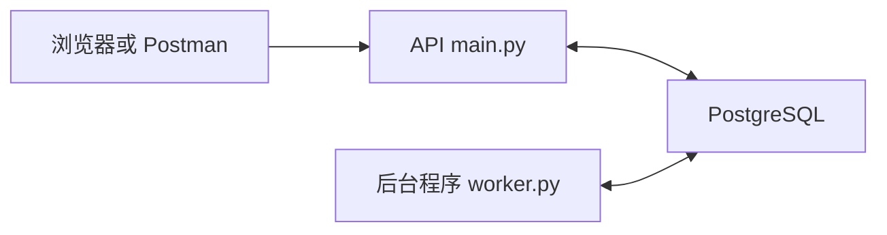

# 后端代码结构说明

当前后端负责验证账号、接收聊天消息、保存 PostgreSQL 待办，再由独立 worker 返回 `Message received.`。本文说明这些功能分别写在哪里。启动命令见 [中文使用说明](README.md)，操作验证见 [手动测试指南](MANUAL_TESTING.md)。评审使用的 [英文版](../../CODE_STRUCTURE.md) 与本文对应。

## 仓库结构

```text
compose.yaml                 启动并连接各个服务
.env.example                 团队共用的配置模板
scripts/init_env.py          生成私有环境配置
backend/
  Dockerfile                 构建运行镜像和测试镜像
  app/                       接口、数据库访问、账号与后台处理
  migrations/                数据库结构的版本化变更
  tests/                     PostgreSQL 集成测试
  requirements*.in           人工维护的依赖清单
  requirements*.txt          解析后固定的依赖版本
  pyproject.toml             测试和代码检查配置
  alembic.ini                数据库迁移工具配置
.github/workflows/ci.yml     GitHub 自动检查流程
docs/                        英文指南和架构资料
docs/developer/zh-CN/        中文团队指南和规划资料
```

不是每个文件都对应一个服务。API、worker、迁移和账号管理命令共用同一份运行镜像，通过不同启动入口完成各自工作。

## 启动与容器

[compose.yaml](../../../compose.yaml) 规定启动顺序：

```text
数据库健康 → migrate 完成迁移 → bootstrap 完成账号初始化
                                      ├─ api 持续运行
                                      └─ worker 持续运行
```

| 服务 | 做什么 | 运行方式 |
| --- | --- | --- |
| `db` | 运行 PostgreSQL，数据保存在 `postgres_data` 数据卷 | 常驻 |
| `migrate` | 执行 `alembic upgrade head`，应用尚未执行的结构变更 | 完成后退出 |
| `bootstrap` | 执行 `app.manage bootstrap`，首个账号不存在时创建它 | 完成后退出 |
| `api` | Uvicorn 运行 `app.main` 中的 FastAPI 应用 | 常驻 |
| `worker` | 运行 `app.worker`，领取并处理待办 | 常驻 |
| `admin` | 按需执行账号管理命令 | 单次命令 |
| `test-db` | 提供独立、可清空的 PostgreSQL 测试数据库 | 仅测试配置启用 |
| `test` | 在测试镜像中运行 pytest | 测试后退出 |

Dockerfile 的 `runtime` 阶段安装运行依赖，并使用非 root 用户执行程序；`test` 阶段再加入测试工具。Compose 把配置传进容器，API 默认只开放到宿主回环地址，数据库只在 Compose 内部网络提供访问。

## 应用代码

以下文件均位于 `backend/app/`。

| 文件 | 职责 |
| --- | --- |
| `__init__.py` | 将这个目录标识为 Python 的 `app` 包 |
| `config.py` | 读取环境变量，构造数据库地址，检查 worker 时间参数 |
| `db.py` | 为各进程建立数据库连接池和 Session 工厂，并释放请求会话 |
| `models.py` | 将四张表映射为 Python 类，声明字段和数据库约束 |
| `schemas.py` | 用 Pydantic 定义接口输入、输出和输入校验规则 |
| `security.py` | 验证 HTTP Basic 凭据、scrypt 密码哈希及账号启用状态 |
| `main.py` | 定义 HTTP 接口，检查资源归属，组织数据库操作 |
| `worker.py` | 领取待办，保存固定回复，记录失败，处理过期领取 |
| `manage.py` | 提供初始化账号、创建账号和修改密码命令 |
| `smoke.py` | 访问真实运行的接口并等待独立 worker，检查完整链路 |

其中三个概念需要分清：**`schemas.py` 定义接口数据，`models.py` 描述存储结构，迁移文件修改真实数据库。** 只改模型代码，不会自动升级已经存在的表。

`main.py` 提供健康检查、当前账号信息、会话创建与列表、消息提交与历史、待办状态等接口。资源归属从身份验证结果取得，不相信客户端填写的用户编号。

## 一条消息如何处理



1. `security.py` 验证账号，`schemas.py` 检查正文和 UUID 提交标识。
2. `main.py` 检查会话归属，锁定会话并分配消息顺序号。
3. 在一个事务中保存用户消息、更新顺序号并创建排队待办，然后返回消息和待办编号。
4. `worker.py` 使用数据库行锁领取工作，跳过其他 worker 已锁定的记录，并保存新的领取令牌和到期时间。
5. worker 生成固定回复，在同一个事务中保存回复、更新会话顺序号并标记成功；提交前再次检查领取权仍有效。
6. 客户端通过 API 查询聊天记录或待办状态。

`messages` 保存“说了什么”，`jobs` 保存“处理到了哪里”。同一提交标识和正文重复到达时返回原编号；标识相同但正文不同则返回 `409`。过期工作可以接管，领取权变化后，旧令牌不能完成工作。本阶段尚未实现长任务的领取续期。

## 数据库迁移

| 文件 | 职责 |
| --- | --- |
| `backend/alembic.ini` | 指定迁移目录和项目导入位置 |
| `backend/migrations/env.py` | 连接数据库，为 Alembic 加载模型元数据 |
| `backend/migrations/script.py.mako` | 创建新迁移文件时使用的模板 |
| `backend/migrations/versions/0001_initial.py` | 用固定 SQL 创建四张初始表、约束和索引 |
| `backend/migrations/versions/0002_english_defaults.py` | 将后续新会话的默认标题改为英文，不重写已有记录 |

Alembic 用 `alembic_version` 表记录已应用的版本，再执行后续迁移。改变结构时增加新迁移，不修改团队已经使用过的迁移。字段细节见 [英文数据库参考](../../BACKEND_DATABASE.md) 或 [中文数据设计](AGENTHUB_BACKEND_INITIAL_DATABASE_DESIGN.md)。

## 依赖和验证

| 文件 | 职责 |
| --- | --- |
| `backend/requirements.in` | 人工维护的直接运行依赖及版本范围 |
| `backend/requirements.txt` | Docker 实际安装的固定运行依赖版本 |
| `backend/requirements-dev.in` | 在运行依赖基础上增加测试、代码检查依赖 |
| `backend/requirements-dev.txt` | 测试镜像安装的固定依赖版本 |
| `backend/pyproject.toml` | pytest 路径及 Ruff 检查、格式化规则 |
| `backend/tests/conftest.py` | 只对隔离测试库执行迁移和清理，准备测试账号及 HTTP 客户端 |
| `backend/tests/test_backend.py` | 检查身份验证、消息流程、重复请求、事务、worker 领取权和迁移 |
| `.github/workflows/ci.yml` | 构建镜像、执行检查和数据库测试，再启动服务执行链路检查 |

集成测试可以控制成功和失败条件，`smoke.py` 则验证真实运行服务之间的 HTTP 链路。当前 CI 负责检查改动，尚未自动发布镜像或部署应用。

## 配置和文档

| 文件或目录 | 职责 |
| --- | --- |
| `.env.example` | 可以提交到 Git 的配置模板，不包含真实凭据 |
| `.env` | 被忽略的实际环境配置，由 `scripts/init_env.py` 生成 |
| `.gitignore` | 排除凭据、虚拟环境和生成的缓存 |
| `.gitattributes` | 统一跨平台的代码与文档换行方式 |
| `backend/.dockerignore` | 排除不需要进入 Docker 构建过程的本地文件 |
| `README.md` | 当前英文启动、接口和团队协作说明 |
| `docs/README.md` | 英文文档索引 |
| `docs/AGENTHUB_TEAM_HANDOVER.md` | 原始英文架构规划，也包含未来功能 |
| `docs/BACKEND_DATABASE.md`、`docs/MANUAL_TESTING.md` | 当前数据库参考、手动测试步骤与记录模板 |
| `docs/developer/README.md` | 开发者文档索引 |
| `docs/developer/zh-CN/` | 中文使用、结构与测试指南，以及此前的后端规划草案 |

## 修改功能时从哪里开始

| 要修改什么 | 从哪里开始 |
| --- | --- |
| 增加或修改接口 | `main.py`、`schemas.py`，然后补充集成测试 |
| 修改数据表 | `models.py`、新增迁移，然后检查迁移测试 |
| 修改后台处理 | `worker.py` 和相关测试 |
| 修改启动方式、端口和服务配置 | `compose.yaml`、`.env.example` |
| 修改身份验证和账号管理 | `security.py` 或 `manage.py` |

系统提示保持英文，代码注释保持中英双语。当前仓库还没有前端实现、模型调用、审批流程、SSE 和模拟业务服务，这些属于后续规划。

建议阅读顺序：`compose.yaml` → `schemas.py` → `models.py` → `main.py` → `worker.py` → 迁移文件 → 测试文件。
